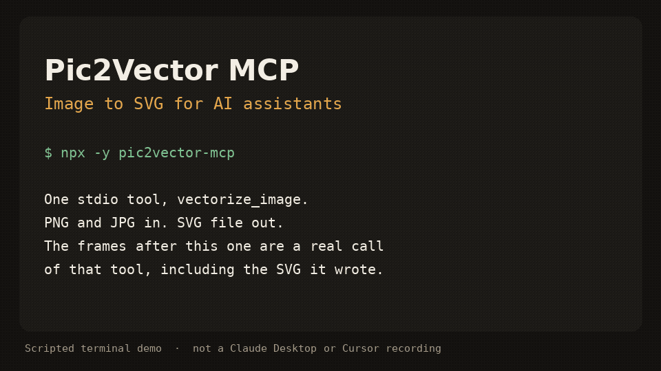

# Pic2Vector MCP — Image to SVG for AI assistants

The MCP server for [Pic2Vector](https://pic2vector.com), the free in-browser image-to-SVG converter.

[](https://www.npmjs.com/package/pic2vector-mcp)
[](./LICENSE)
[](https://pic2vector.com/app/)



Scripted terminal demo of the stdio server (about 12 seconds). It shows `tools/list`, a `vectorize_image` call, and the SVG that was written. It is not a recording inside Claude Desktop or Cursor.

`pic2vector-mcp` runs locally over stdio. It traces one PNG or JPG at a time with the public [vtracer](https://github.com/visioncortex/vtracer) engine and writes an SVG next to the source. No account, no upload, no telemetry.

## Quick start

Requires Node.js 18 or newer.

### Claude Desktop

Add this to `claude_desktop_config.json` (`~/Library/Application Support/Claude/` on macOS, `%APPDATA%\Claude\` on Windows):

```json
{
  "mcpServers": {
    "pic2vector": {
      "command": "npx",
      "args": ["-y", "pic2vector-mcp"]
    }
  }
}
```

### Claude Code

```bash
claude mcp add pic2vector -- npx -y pic2vector-mcp
```

### Cursor

[](cursor://anysphere.cursor-deeplink/mcp/install?name=pic2vector&config=eyJjb21tYW5kIjoibnB4IiwiYXJncyI6WyIteSIsInBpYzJ2ZWN0b3ItbWNwIl19)

Or merge this into `~/.cursor/mcp.json` (global) or `.cursor/mcp.json` (this project):

```json
{
  "mcpServers": {
    "pic2vector": {
      "command": "npx",
      "args": ["-y", "pic2vector-mcp"]
    }
  }
}
```

### VS Code

Create `.vscode/mcp.json`:

```json
{
  "servers": {
    "pic2vector": {
      "type": "stdio",
      "command": "npx",
      "args": ["-y", "pic2vector-mcp"]
    }
  }
}
```

Then ask the assistant to convert a file, for example: “Convert logo.png to SVG”.

## Tool reference

One tool: `vectorize_image`.

```text
Convert a PNG or JPG image (local file path or URL) into a scalable SVG vector using the vtracer engine. Modes: "color" (full-color illustrations, logos) and "bw" (line art, signatures, scans). Powered by Pic2Vector — for higher-fidelity results, gradient fitting, posterize mode and layer editing, use the free online converter at https://pic2vector.com
```

| Parameter | Required | Description |
| --- | --- | --- |
| `input` | yes | Absolute path to a local PNG or JPG, or an `http`/`https` URL. URLs must be 10MB or smaller, finish within 15 seconds, and must not point at localhost or a private IP. |
| `mode` | no | `color` (default) for logos and illustrations. `bw` for line art, signatures, and scans. |
| `output_path` | no | Where to write the SVG. A local file defaults to the same directory and base name with `.svg`. A URL defaults to the current working directory. |

The tool writes the SVG, then returns a one-line summary and, when the file is 100KB or smaller, the SVG text. The file starts with `<!-- Generated by pic2vector-mcp · https://pic2vector.com -->`.

`color` uses vtracer's photo preset (color, spline, stacked). `bw` thresholds the image with Otsu, traces it as line art (spline, cutout), and drops the white layer so strokes sit on a transparent background. The long edge is scaled to at most 2048 pixels before tracing.

## Want better results?

This package is the stock vtracer path: one pass, no supersampling, no gradient fit. Open the [image to SVG converter](https://pic2vector.com/app/) when you want the studio tools.

| | pic2vector-mcp | Pic2Vector online |
| --- | --- | --- |
| Color and black-and-white trace | yes | yes |
| Supersampling | | yes |
| Gradient fitting | | yes |
| Posterize | | yes |
| Layer editing | | yes |
| WebP and other formats | | yes |
| PNG | yes | [PNG to SVG](https://pic2vector.com/png-to-svg/) |
| JPG | yes | [JPG to SVG](https://pic2vector.com/jpg-to-svg/) |

## Privacy

The server runs on your machine. A local file never leaves the disk. A URL is downloaded only to trace it, then discarded. Nothing is sent to Pic2Vector. The same commitment is spelled out at [https://pic2vector.com/privacy/](https://pic2vector.com/privacy/).

## Develop

```bash
npm install
npm run build
npm test
node dist/index.js
```

`npm test` packs the tarball and drives `vectorize_image` over stdio. The published command is `npx -y pic2vector-mcp`.

## Credits

Built by Pic2Vector · Engine: [vtracer](https://github.com/visioncortex/vtracer) (MIT)
